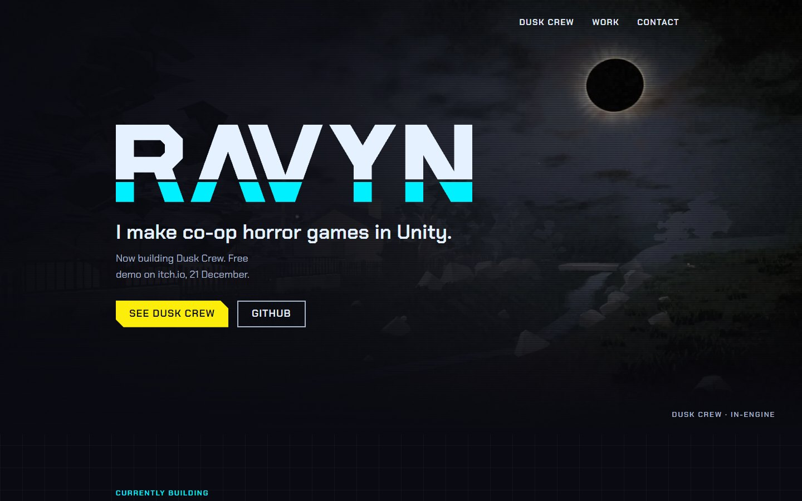
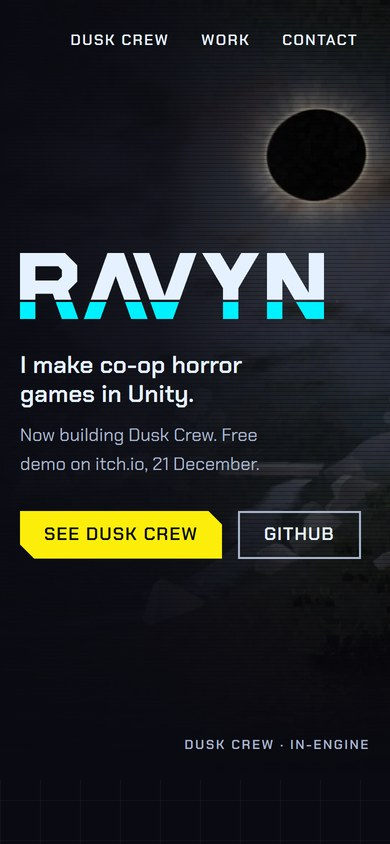

# ravynarchlab-source.github.io

The source of [ravynarchlab-source.github.io](https://ravynarchlab-source.github.io): RAVYN's portfolio. One static page, no framework, no build step.

<p>
  
  
</p>

## How it is built

- `index.html` holds everything: markup, inline CSS, and a few lines of script that play the reel only while it is on screen.
- First load is about 150 KB. The hero image is 49 KB, each font file 8 KB.
- Chakra Petch is subset to Latin and served from `assets/fonts` (SIL Open Font License, text included).
- The reel is a 530 KB MP4 that loads on demand. With reduced motion it stays a still with controls.
- Colours, type and spacing come from the RAVYN identity tokens.

## Run it

```
python -m http.server
```

Then open `http://localhost:8000`.

## Licence

The code (HTML, CSS, JavaScript) is MIT. The RAVYN wordmark and the Dusk Crew images and video are © RAVYN, all rights reserved. See [LICENSE](LICENSE).
